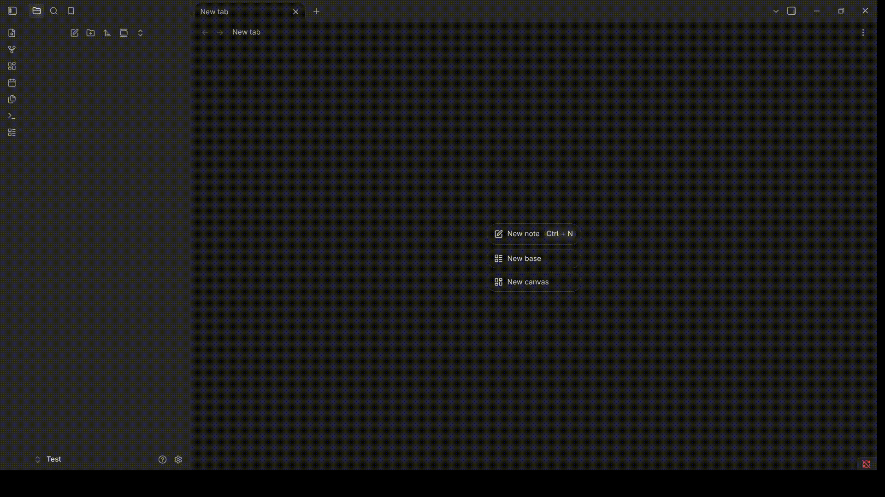

# Readest Extractor

An Obsidian plugin being developed to turn a local Readest ebook library into book notes containing metadata, reading progress, covers, highlights, and annotations.

- [Screenshots](#screenshots)
- [Getting started](#getting-started)
- [Usage](#usage)
- [Privacy and safety](#privacy-and-safety)
- [Development roadmap](#development-roadmap)
- [Release instructions](#release-instructions)

## Screenshots


_Scan command in the Obsidian command palette._

- [ ] Completed scan summary.
- [ ] Generated book note with metadata and annotations.
- [ ] Book cover embedded in a note.
- [ ] Plugin settings tab.

## Getting started

### Requirements

- Desktop Obsidian.
- A local Readest library.
- npm.

### Build and install

1. Obtain the project source.
2. Open a terminal in the project root.
3. Install dependencies:

   ```sh
   npm install
   ```

4. Create a production build:

   ```sh
   npm run build
   ```

5. Place these files inside your vault:

   ```text
   <Vault>/.obsidian/plugins/readest-extractor/
   ├── main.js
   ├── manifest.json
   └── styles.css
   ```

6. Reload Obsidian.
7. Enable **Readest Extractor** under **Settings → Community plugins**.

## Usage

### Scan your Readest library

1. Confirm that your Readest library exists at the configured location.
2. Open Obsidian's command palette.
3. Select **Readest Extractor: Scan Readest library**.
4. Read the summary notice.
5. If any books failed, inspect the developer console for messages beginning
   with `[Readest Extractor]`.

Expected Readest directory structure:

```text
Books/
├── library.json
├── library.json.bak
└── <bookHash>/
    ├── config.json
    ├── cover.png
    └── ebook.epub
```

## Privacy and safety

- The current scan operates locally without network requests or cloud services.
- Node.js filesystem APIs read the external Readest library.
- The scan does not modify the Readest library or the Obsidian vault.
- Diagnostic messages can include book titles and hashes; review logs before
  sharing them.

## Development roadmap

Checked items represent implemented foundations, not completion of every
related phase.

### Library scanning

- [x] Define raw Readest interfaces.
- [x] Read `library.json`.
- [x] Exclude deleted books and annotations.
- [x] Read per-book configuration files.
- [x] Support missing configuration files.
- [x] Isolate per-book failures.
- [x] Provide a read-only scan command and one summary notice.
- [x] Manually confirm scanning works without vault changes.

### Normalization

- [x] Introduce normalized book and annotation types.
- [x] Combine basic library metadata with book configuration.
- [x] Normalize books without annotations.
- [x] Verify missing-field defaults.
- [x] Validate malformed data shapes and normalization edge cases.

### Markdown rendering

- [x] Add a pure Markdown renderer foundation.
- [x] Generate YAML properties safely.
- [x] Complete metadata and progress rendering.
- [x] Group annotations by page, with an unknown-location fallback.
- [x] Add generated-section markers and a personal writing area.

### Safe note creation and import

- [x] Add a create-only Vault API writer foundation.
- [x] Add initial book-hash lookup and filename-collision checks.
- [x] Harden filename sanitization and collision reporting.
- [x] Confirm repeated imports do not create duplicates.
- [x] Add the full library import command.
- [x] Report created, skipped, and failed counts.

> [!notice]
> Import creates new notes in the vault without overwritting existing items or modify Readest

### Synchronization

- [x] Find existing notes by `readest_book_hash`.
- [ ] Replace only the marked annotation section.
- [ ] Preserve all content outside generated markers.
- [ ] Reflect changed and deleted Readest annotations.
- [ ] Safely skip notes with missing or ambiguous markers.
- [ ] Verify personal writing survives repeated synchronization.

### Settings and covers

- [x] Define the default Linux Readest path.
- [ ] Add settings UI and persistence.
- [ ] Validate the configured library path.
- [ ] Expand a user-entered leading `~`.
- [ ] Configure output and cover folders.
- [ ] Import covers through the Vault API.
- [ ] Avoid duplicate cover files and handle missing covers.

## Release instructions

For a future release:

1. Run `npm run lint` and `npm run build`.
2. Complete the manual checks in Obsidian.
3. Update versions consistently in `manifest.json` and `package.json`.
4. Update `versions.json` and confirm the minimum supported Obsidian version.
5. Create a GitHub release tagged with the exact version, without a leading `v`.
6. Attach `main.js`, `manifest.json`, and `styles.css` if present.
7. Review Obsidian's developer policies and plugin guidelines before submission.
